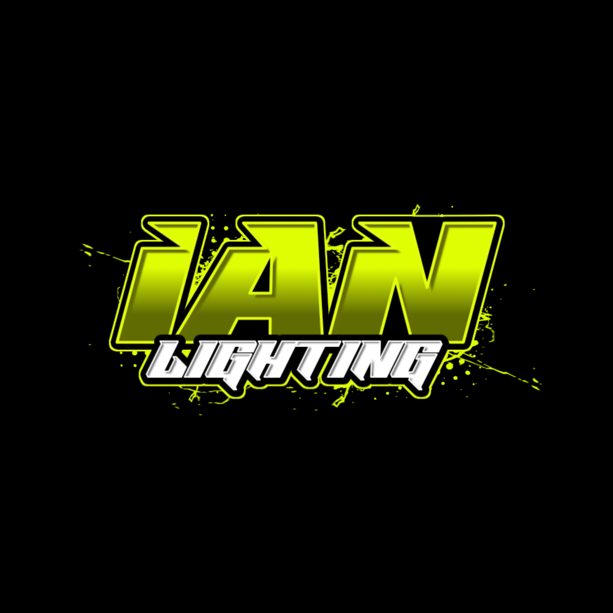
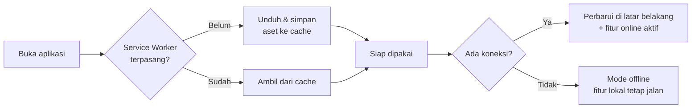
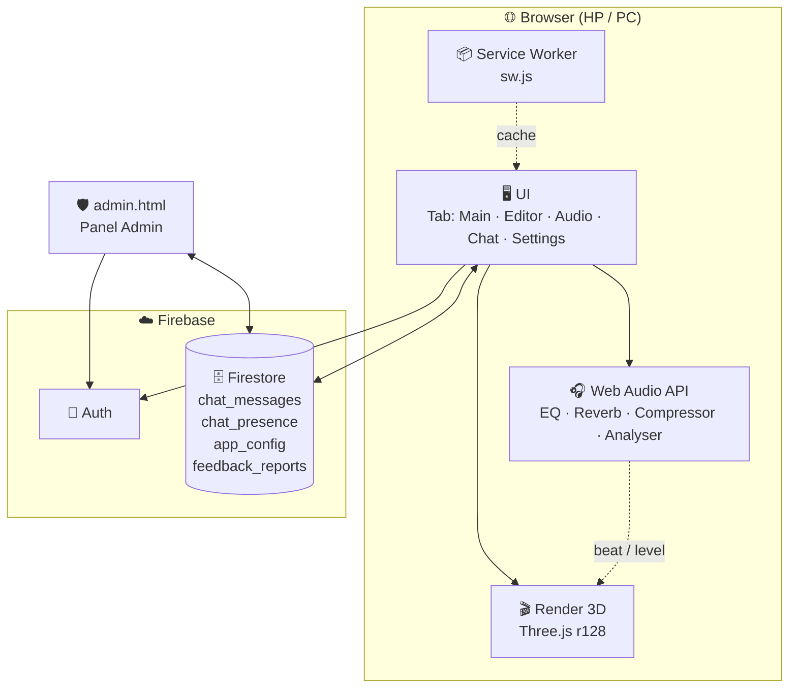
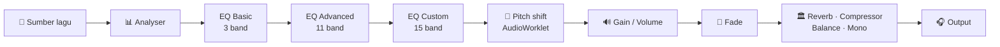

<div align="center">



# 💡 Ian Lighting &nbsp;·&nbsp; Photonic Mixer Pro

### Simulator & mixer lighting panggung 3D langsung di browser

*Remake dari karya IJUL, dibangun ulang dengan Three.js, Firebase, dan PWA.*

<br />


<br />

[🚀 Buka Aplikasi](https://roichan-cloud.github.io/Photonic-Mixer-Remake/) &nbsp;•&nbsp;
[✨ Fitur](#-fitur-utama) &nbsp;•&nbsp;
[📦 Instalasi](#-instalasi--menjalankan) &nbsp;•&nbsp;
[🔥 Firebase](#-pengaturan-firebase) &nbsp;•&nbsp;
[🤝 Kontribusi](#-kontribusi)

</div>

---

## 📑 Daftar Isi

<details open>
<summary><b>Klik untuk membuka / menutup</b></summary>

- [🌟 Tentang Proyek](#-tentang-proyek)
- [✨ Fitur Utama](#-fitur-utama)
- [🗂️ Penjelasan Tab](#️-penjelasan-tab)
  - [🎛️ Tab Main](#️-tab-main)
  - [🛠️ Tab Editor](#️-tab-editor)
  - [🎧 Tab Audio](#-tab-audio)
  - [💬 Tab Chat](#-tab-chat)
  - [⚙️ Tab Settings](#️-tab-settings)
- [📺 Videotron](#-videotron)
- [🎥 Kontrol Kamera 3D](#-kontrol-kamera-3d)
- [📱 PWA & Mode Offline](#-pwa--mode-offline)
- [🧱 Arsitektur](#-arsitektur)
- [📁 Struktur Proyek](#-struktur-proyek)
- [📦 Instalasi & Menjalankan](#-instalasi--menjalankan)
- [🔥 Pengaturan Firebase](#-pengaturan-firebase)
- [🛡️ Panel Admin](#️-panel-admin)
- [💾 Simpan & Muat Project](#-simpan--muat-project)
- [🧪 Halaman Uji Chat](#-halaman-uji-chat)
- [🛠️ Teknologi](#️-teknologi)
- [❓ FAQ & Pemecahan Masalah](#-faq--pemecahan-masalah)
- [🗺️ Rencana Pengembangan](#️-rencana-pengembangan)
- [🤝 Kontribusi](#-kontribusi)
- [📜 Lisensi & Kredit](#-lisensi--kredit)

</details>

---

## 🌟 Tentang Proyek

**Ian Lighting (Photonic Mixer Pro)** adalah aplikasi web untuk **mensimulasikan dan memainkan lighting panggung dalam ruang 3D**. Anda bisa menata lampu, memutar musik, memicu efek gerak, strobo, dan chase secara langsung, seperti sedang memegang mixer lighting sungguhan, tetapi cukup dari browser di HP atau komputer.

> [!NOTE]
> Seluruh aplikasi berada di **satu file `index.html`**. Tidak ada proses build, tidak ada `npm install`. Cukup unggah ke hosting statis seperti GitHub Pages, lalu buka.

### 🎯 Cocok untuk

| Pengguna | Manfaat |
|---|---|
| 🎤 Operator lighting | Latihan dan menyusun *cue* sebelum tampil |
| 🎶 Kreator konten | Merekam tampilan viewport 3D sebagai video |
| 🏫 Pelajar & penggemar | Belajar cara kerja lampu panggung tanpa alat mahal |
| 🧑‍💻 Pengembang | Contoh proyek Three.js + Firebase + PWA dalam satu file |

---

## ✨ Fitur Utama

<table>
<tr>
<td width="50%" valign="top">

### 🌐 Viewport 3D
- Panggung 3D real-time (Three.js r128)
- Kamera bisa diputar, di-zoom, **digeser**, dan dijalankan maju-mundur
- Joystick virtual untuk HP, **keyboard untuk komputer**
- Kualitas render bisa diatur
- Rekam viewport 3D menjadi video

</td>
<td width="50%" valign="top">

### 💡 Banyak jenis fixture
- Lampu beam (moving head) dengan gobo, warna, dan prisma
- Parled, Wallwasher LED, Strobo kotak 36 titik
- Lampu kipas 3D dengan 3 bilah yang berputar
- Rigging truss, Videotron, Banner, Foto 2D, dan Model 3D

</td>
</tr>
<tr>
<td width="50%" valign="top">

### 🎬 Efek & gerakan
- Generator gerakan (FX): Circle, Wave, Snake, Matrix, Sunburst, dan lainnya
- Master Strobe, Split Strobe, Flash All, Blackout, Freeze
- Chase, Gobo, dan Color **Frame Manager**
- Tap tempo dan pengaturan smooth, speed, spread

</td>
<td width="50%" valign="top">

### 🎧 Audio mixer
- Playlist, waveform, dan visualizer spektrum
- Speed (tempo) dan Pitch yang terpisah
- **EQ 3 mode:** Basic, Advanced (11 band), Custom (15 band)
- Balance kiri/kanan, Mono, Reverb, Compressor, Fade

</td>
</tr>
<tr>
<td width="50%" valign="top">

### 📺 Videotron
- Putar video di layar 3D, banyak bentuk layar
- **Edge RGB** berputar dengan warna kustom
- **Placeholder "NO SIGNAL"** saat belum ada video
- Crop, zoom, corner radius, dan kecerahan

</td>
<td width="50%" valign="top">

### ☁️ Online & komunitas
- **Chat real-time** bergaya WhatsApp
- Balas dengan geser, salin teks, hapus pesan sendiri
- **Panel Admin** dengan moderasi lengkap
- Login dan data lewat Firebase

</td>
</tr>
</table>

### 🧩 Sorotan teknis

- ✅ **Satu file**, tanpa build step
- ✅ **PWA**: bisa dipasang ke layar utama dan jalan offline
- ✅ **Multi-touch** di HP: beberapa tombol bisa ditekan bersamaan
- ✅ **Dua bahasa** (Indonesia dan Inggris) lewat sistem i18n
- ✅ **Tema warna** yang bisa diganti
- ✅ Dukungan **MIDI hardware** (Minibrute) untuk kontrol fisik
- ✅ Mode **Anti-Lag** dan **Deteksi Offline Otomatis**

---

## 🗂️ Penjelasan Tab

Aplikasi punya lima tab utama di bagian atas layar.

```text
┌──────────────────────────────────────────────────────┐
│   Main   │   Editor   │   Audio   │   Chat   │   ⚙   │
└──────────────────────────────────────────────────────┘
```

### 🎛️ Tab Main

Tempat Anda **bermain** dengan lampu secara langsung.

<details>
<summary><b>📋 Lihat daftar kontrol</b></summary>

| Kelompok | Isi |
|---|---|
| 🎯 **Master** | `MASTER STROBE`, `MASTER GOBO / MODE`, `BLACKOUT`, `FLASH ALL`, `FLASH MB`, `FREEZE` |
| 🎞️ **Frame Manager** | `CHASE FRAME MANAGER`, `GOBO FRAME MANAGER`, `COLOR FRAME MANAGER` |
| 🌀 **Generator gerakan (FX)** | `CIRCLE`, `MIRROR CIR`, `BOUNCE`, `WAVE`, `SNAKE`, `MATRIX`, `ZIG-ZAG`, `SUNBURST`, `CHAOS`, `RANDOM SMOOTH`, `SWEEP UP`, `L-R SWIPE`, `LOOP SWIPE`, `ODD-EVEN`, `SPLIT STROBE`, `PRISM`, `RAINBOW PRISM`, dan lainnya |
| 🎚️ **Transisi & kecepatan** | `SMOOTH (SEQ)`, `COLOR SMOOTH`, `DELAY`, `SPEED`, `SPREAD`, `MB SMOOTH`, `GERAK SMOOTH` |
| ⏱️ **Tempo** | `TAP TEMPO`, `KUNCI SPD` |
| 💾 **Project** | `SAVE PROJECT`, `LOAD PROJECT`, `RESET` |

</details>

> [!TIP]
> Di HP, Anda bisa menekan **beberapa tombol sekaligus** (multi-touch). Tidak perlu melepas jari dari `FLASH MB` untuk menekan tombol lain.

### 🛠️ Tab Editor

Tempat Anda **menata dan mengatur detail** setiap fixture.

<details>
<summary><b>📋 Lihat daftar panel</b></summary>

| Panel | Fungsi |
|---|---|
| 🔦 **Beam** | Atur skala, posisi, dan perilaku lampu beam |
| 🏗️ **Rigging Structure (White Truss)** | Tambah dan atur struktur truss |
| 🟦 **Parled** | Jumlah, posisi, dan warna Parled |
| 🌈 **Wallwasher LED Flow Bar** | Hingga 99 unit, pola aliran, dan **warna rainbow kustom 1 sampai 5 warna** |
| ⚡ **Strobo Kotak LED** | Strobo 36 titik |
| 🌀 **Lampu Kipas** | Kipas 3D dengan 3 bilah berputar, glow tengah, ikut strobe |
| 📺 **Videotron** | Layar video 3D, lihat [bagian Videotron](#-videotron) |
| 🖼️ **Banner** | Tampilkan gambar PNG, JPG, atau JPEG di panggung |
| 📷 **Foto 2D** | Tempel foto sebagai objek 2D |
| 🧊 **Model 3D** | Impor model 3D (OBJ / FBX) |
| 🎹 **Minibrute Hardware Control** | Hubungkan perangkat MIDI untuk kontrol fisik |

</details>

> [!IMPORTANT]
> Setiap panel mendukung **empat gaya input slider**: Slider, Manual, Text, dan tombol `-` / `+`, sehingga nyaman dipakai di layar kecil maupun komputer.

### 🎧 Tab Audio

Mixer audio dengan pemutar musik yang terhubung ke seluruh efek lighting.

<details>
<summary><b>📋 Lihat semua fitur audio</b></summary>

| Bagian | Fitur |
|---|---|
| 📜 **Playlist** | Banyak lagu, auto-lanjut, repeat |
| ▶️ **Player** | Play, pause, seek, volume (bisa lebih dari 100 persen) |
| 🐢 **Speed (Tempo)** | 0.5x sampai 2x, nada tetap terjaga |
| 🎼 **Pitch (Nada)** | -12 sampai +12 semitone, durasi tidak berubah |
| 🎚️ **Equalizer** | Tiga mode, lihat tabel di bawah |
| 🌅 **Fade In/Out** | Pembuka dan penutup lagu yang halus |
| 🌊 **Waveform** | Bentuk gelombang lagu |
| 📊 **Visualizer spektrum** | Spektrum frekuensi real-time |
| ↔️ **Balance & Mono** | Atur kiri/kanan, atau gabungkan ke mono |
| 🏛️ **Efek** | Reverb dan Compressor |
| 💥 **Auto Flash Beat** | Flash otomatis mengikuti ketukan |

</details>

#### 🎚️ Mode Equalizer

| Mode | Band | Keterangan |
|:---:|:---:|---|
| 🟢 **BASIC** | 3 | Bass, Mid, Treble |
| 🔵 **ADVANCED** | 11 | Sub-bass, Low bass, Upper bass, Low mid, Midrange, Upper mid, Presence, Brilliance, Treble, High treble, Air |
| 🟣 **CUSTOM** | 15 | Parametrik: **frekuensi tiap band bisa diketik** (20 sampai 20.000 Hz), penguatan -20 sampai +20 dB |

<details>
<summary><b>🎼 Frekuensi tengah mode Advanced</b></summary>

| Band | Frekuensi | Tipe filter |
|---|---:|---|
| Sub-bass | 50 Hz | Low shelf |
| Low bass | 90 Hz | Peaking |
| Upper bass | 160 Hz | Peaking |
| Low mid | 350 Hz | Peaking |
| Midrange | 1 kHz | Peaking |
| Upper mid | 2,5 kHz | Peaking |
| Presence | 5 kHz | Peaking |
| Brilliance | 7,5 kHz | Peaking |
| Treble | 10 kHz | Peaking |
| High treble | 13 kHz | Peaking |
| Air | 15 kHz | High shelf |

</details>

> [!NOTE]
> Hanya **satu mode EQ yang aktif** pada satu waktu. Saat Anda berpindah mode, nilai slider mode lain tetap diingat dan kembali ketika Anda pindah balik. Tombol `RESET` hanya mereset mode yang sedang tampil.

### 💬 Tab Chat

Ruang obrolan publik **real-time** bergaya WhatsApp.

| Fitur | Keterangan |
|---|---|
| 👤 **Nama panggilan** | Cukup nama panggilan, tanpa akun |
| 🟢 **Status online** | Lihat siapa yang sedang aktif |
| 👆 **Ketuk pesan** | Muncul menu dari bawah: **Balas** dan **Salin teks** |
| 👉 **Geser ke kanan** | Masuk mode balas, seperti WhatsApp |
| 🗑️ **Hapus pesan sendiri** | Hanya pesan milik Anda |
| 📅 **Penanda hari** | Pemisah "Hari ini", "Kemarin", dan seterusnya |
| ✔️ **Centang biru admin** | Pesan admin diberi tanda khusus |

### ⚙️ Tab Settings

<details>
<summary><b>📋 Lihat semua pengaturan</b></summary>

| Pengaturan | Fungsi |
|---|---|
| 🎥 **Rekam Viewport 3D** | Rekam hanya tampilan 3D, bukan seluruh layar HP |
| 🎨 **Tema Warna** | Hijau, biru, merah, ungu, oranye, cyan |
| 📂 **Auto-Load Project** | Muat project terakhir otomatis |
| 🔀 **Multi Gerakan** | Jalankan beberapa gerakan sekaligus |
| 🧭 **Geser Kamera** | Joystick dan kontrol keyboard |
| 🚀 **Anti-Lag** | Kurangi beban saat banyak fixture aktif |
| 📡 **Deteksi Offline Otomatis** | Beralih ke mode offline saat koneksi hilang |
| 🌐 **Bahasa / Language** | Indonesia dan Inggris |
| 🖥️ **Kualitas Render 3D** | Sesuaikan dengan kemampuan perangkat |

</details>

---

## 📺 Videotron

Layar video 3D yang bisa dijumlahkan hingga **8 unit**, masing-masing bisa dipilih dan diatur sendiri.

### 🎞️ Kemampuan dasar

- 🎬 Unggah dan putar video (`MP4` dan format video lain), dengan `LOOP` dan `SUARA`
- 🔷 **11 bentuk layar:** Rect, Circle, Triangle, Diamond, Hexagon, Star, Arch, Chevron L/R, Zigzag L/R
- ✂️ **Crop dan zoom** lewat jendela khusus
- 🔆 Kecerahan, corner radius, warna dan ukuran frame
- ⚡ Opsi **Ikut Master Strobe** dan **Ikut Flash MB**

### 🌈 Edge RGB

Outline berwarna yang **bergerak searah jarum jam** di sekeliling layar.

| Kontrol | Fungsi | Bawaan |
|---|---|:---:|
| `EDGE SIZE` | Ketebalan edge. **0 berarti edge mati** | `0` |
| `EDGE SPEED` | Kecepatan putaran warna | `40` |
| `EDGE BRIGHT` | Kecerahan edge | `100` |
| `EDGE GLOW` | Cahaya lembut di luar edge | `50` |
| 🔄 Arah | Searah atau berlawanan jarum jam | Searah |
| 🎨 `HALUS / TEGAS` | Peralihan warna mulus atau berblok | Halus |
| 🖌️ **Warna edge** | Warna bebas lewat color wheel, **1 sampai 8 warna** | Merah, hijau, biru |

> [!TIP]
> Edge muncul di **luar frame**. Set `FRAME SIZE` ke `0` jika ingin edge menempel langsung ke video.

### 📡 Placeholder "NO SIGNAL"

Videotron yang **belum punya video** menampilkan layar hitam dengan tulisan **`VT n`** berwarna hijau di tengah atas dan **`NO SIGNAL`** berwarna putih di bawahnya.

- Placeholder hilang otomatis begitu video dimuat ke Videotron tersebut.
- Videotron lain yang masih kosong tetap menampilkan placeholder.
- Mengikuti bentuk layar dan corner radius, dan teks tidak melar di layar non-16:9.

---

## 🎥 Kontrol Kamera 3D

| Aksi | 📱 HP | 💻 Komputer |
|---|---|---|
| 🔄 Putar | Seret satu jari | Seret mouse |
| 🔍 Zoom | Cubit dua jari | Roda mouse |
| ↔️ Geser maju / mundur / kiri / kanan | **Joystick virtual** | Tombol <kbd>←</kbd> <kbd>→</kbd> <kbd>↑</kbd> <kbd>↓</kbd> |
| ↕️ Naik / turun | Kontrol atas-bawah | <kbd>Page Up</kbd> / <kbd>Page Down</kbd> |
| 🏠 Reset posisi | Tombol `RESET POSISI` di Settings | Tombol `RESET POSISI` di Settings |

---

## 📱 PWA & Mode Offline

Aplikasi dapat **dipasang ke layar utama** dan tetap berjalan tanpa internet.



| Jenis file | Strategi cache |
|---|---|
| 📄 Halaman HTML | **Network first**: ambil versi terbaru, cadangan dari cache |
| 🖼️ Aset lokal | **Stale-while-revalidate**: cepat, diperbarui diam-diam |
| 📚 Library CDN dan gambar kipas | **Cache first**: sekali unduh, selanjutnya dari cache |
| 🔥 Firebase / Firestore | Tidak di-cache, ditangani langsung oleh browser |

> [!WARNING]
> Setelah mengubah `index.html`, **naikkan `VERSION` di `sw.js`** supaya perangkat pengguna membuang cache lama. Samakan juga dengan versi yang tertulis di `index.html`.

---

## 🧱 Arsitektur



### 🔊 Alur audio



---

## 📁 Struktur Proyek

```text
Photonic-Mixer-Remake/
├── 📄 index.html          # Aplikasi utama (semua fitur dalam satu file)
├── 🛡️ admin.html          # Panel admin (moderasi chat, dll.)
├── 🧪 chat.html           # Halaman uji khusus fitur chat
├── 📦 sw.js               # Service Worker (cache & offline)
├── 🧾 manifest.json       # Manifest PWA
├── 🔥 firebase-config.js  # Konfigurasi Firebase milik Anda
├── 🔒 firestore.rules     # Aturan keamanan Firestore
├── 📝 chat-rules.txt      # Catatan aturan khusus chat
├── 🖼️ app.png             # Ikon aplikasi
├── 🖼️ logo.png            # Logo
├── 🖼️ kipas.png           # Tekstur lampu kipas (dimuat dari GitHub raw)
└── 📖 README.md           # Dokumen ini
```

> [!NOTE]
> Nama dan keberadaan file pendukung (`manifest.json`, `firebase-config.js`, gambar) mengikuti repositori Anda. Sesuaikan bagian ini bila berbeda.

---

## 📦 Instalasi & Menjalankan

### 🅰️ Cara tercepat: GitHub Pages

1. **Fork** atau salin repositori ini ke akun GitHub Anda.
2. Buka **Settings → Pages**.
3. Pada *Build and deployment*, pilih **Deploy from a branch**, lalu branch `main` dan folder `/ (root)`.
4. Tunggu beberapa menit, lalu buka:

```text
https://<username>.github.io/<nama-repo>/
```

### 🅱️ Jalankan di komputer sendiri

> [!IMPORTANT]
> Service Worker dan Firebase **tidak berjalan dari `file://`**. Gunakan server lokal.

```bash
# Salin repositori
git clone https://github.com/Roichan-cloud/Photonic-Mixer-Remake.git
cd Photonic-Mixer-Remake

# Pilih salah satu server lokal
python3 -m http.server 8080
# atau
npx serve .
```

Lalu buka `http://localhost:8080` di browser.

### 📲 Pasang sebagai aplikasi (PWA)

| Perangkat | Langkah |
|---|---|
| 🤖 **Android (Chrome)** | Menu ⋮ → **Instal aplikasi** / **Tambahkan ke layar utama** |
| 🍎 **iPhone (Safari)** | Tombol Bagikan → **Tambah ke Layar Utama** |
| 💻 **Komputer (Chrome / Edge)** | Ikon instal di bilah alamat |

---

## 🔥 Pengaturan Firebase

Fitur **Chat**, **Panel Admin**, dan **laporan masukan** memerlukan Firebase. Bagian lain aplikasi tetap berjalan tanpa Firebase.

<details>
<summary><b>🪜 Langkah pengaturan</b></summary>

1. Buka [Firebase Console](https://console.firebase.google.com/) dan buat proyek.
2. Aktifkan **Authentication** dan metode login yang Anda pakai (misalnya Anonymous dan Email/Password untuk admin).
3. Aktifkan **Cloud Firestore**.
4. Salin konfigurasi web app ke `firebase-config.js`:

```js
// firebase-config.js
window.firebaseConfig = {
  apiKey:            "ISI_DENGAN_MILIK_ANDA",
  authDomain:        "proyek-anda.firebaseapp.com",
  projectId:         "proyek-anda",
  storageBucket:     "proyek-anda.appspot.com",
  messagingSenderId: "000000000000",
  appId:             "1:000000000000:web:xxxxxxxx"
};
```

5. Tempel isi `firestore.rules` ke **Firestore → Rules**, lalu **Publish**.
6. Ganti UID admin di aturan dan di `admin.html` dengan UID akun admin Anda.

</details>

### 🗄️ Koleksi Firestore yang dipakai

| Koleksi | Isi | Siapa yang menulis |
|---|---|---|
| `chat_messages` | Pesan chat | Pengguna (pesan sendiri), admin |
| `chat_presence` | Status online | Pengguna |
| `app_config` | Pengaturan chat (slow mode, mute, dll.) | Admin |
| `feedback_reports` | Laporan dan saran | Pengguna |

> [!CAUTION]
> **Jangan** menaruh UID admin, kunci rahasia, atau data pribadi di repositori publik tanpa menyadari risikonya. Konfigurasi web Firebase memang bersifat publik, tetapi **keamanan sebenarnya ada pada `firestore.rules`**. Periksa aturan Anda sebelum memublikasikan.

---

## 🛡️ Panel Admin

Buka `admin.html` dan masuk dengan akun admin. Panel **Chat** menyediakan:

| Fitur | Keterangan |
|---|---|
| 💬 **Live Chat** | Pantau dan balas langsung sebagai admin |
| ✔️ **Centang biru** | Pesan admin ditandai khusus |
| 📌 **Pin pesan** | Sematkan pesan penting di atas |
| 🌟 **Pesan sorot** | Beri penekanan visual pada pesan |
| 🔇 **Mute sementara** | Bisukan pengguna untuk durasi tertentu |
| 🚫 **Blokir** | Blokir pengguna bermasalah |
| 🐌 **Slow mode** | Batasi jeda antar pesan |
| 🧹 **Bersihkan** | Hapus pesan secara massal |
| ✏️ **Nama admin** | Nama tampilan admin bisa diubah |

> [!NOTE]
> Pesan admin **tidak dapat dihapus oleh pengguna biasa**. Hanya admin yang berwenang menghapusnya.

---

## 💾 Simpan & Muat Project

Seluruh susunan panggung dapat disimpan ke file dan dimuat kembali.

| Tombol | Fungsi |
|---|---|
| 💾 `SAVE PROJECT` | Unduh file project berisi posisi, pengaturan, dan data fixture |
| 📂 `LOAD PROJECT` | Muat file project |
| 🔁 `RESET` | Kembalikan pengaturan ke bawaan |
| ⚡ **Auto-Load** | Muat project terakhir otomatis saat aplikasi dibuka |

<details>
<summary><b>🧬 Apa saja yang ikut tersimpan?</b></summary>

- Posisi dan pengaturan lampu, truss, Parled, Wallwasher, Strobo, dan Lampu Kipas
- **Videotron** lengkap: bentuk, ukuran, crop, frame, dan seluruh pengaturan **Edge RGB**
- Banner, Foto 2D, dan Model 3D
- Status tampil/sembunyi dan opsi "ikut strobe"

</details>

> [!NOTE]
> File project dari versi lama **tetap bisa dibuka**. Bagian yang belum ada di file lama otomatis memakai nilai bawaan (misalnya Edge RGB mati). Jika versi file berbeda dari versi aplikasi, muncul dialog kompatibilitas dan Anda disarankan menyimpan ulang. Pengaturan **Equalizer** belum ikut tersimpan di file project.

---

## 🧪 Halaman Uji Chat

`chat.html` adalah halaman **mandiri** yang hanya berisi fitur tab Chat. Gunanya untuk menguji koneksi Firebase dan aturan Firestore tanpa memuat seluruh aplikasi.

```text
https://<username>.github.io/<nama-repo>/chat.html
```

---

## 🛠️ Teknologi

| Lapisan | Teknologi |
|---|---|
| 🎨 **Tampilan 3D** |  (ShaderMaterial untuk Edge RGB, ShapeGeometry untuk Videotron) |
| 🔊 **Audio** |  |
| ☁️ **Backend** |  (Firestore, Auth) |
| 📱 **PWA** | Service Worker + Web App Manifest |
| 🧩 **Bahasa** | HTML, CSS, JavaScript murni (tanpa framework) |
| 🌍 **Hosting** | GitHub Pages |

---

## ❓ FAQ & Pemecahan Masalah

<details>
<summary><b>🔇 Suara hanya keluar di speaker atas / hanya kiri di headset (khusus PWA)</b></summary>

Masalah ini berkaitan dengan cara pemutaran audio di PWA. Pastikan Anda memakai versi terbaru, hapus cache aplikasi (hapus PWA lalu pasang ulang), kemudian coba lagi. Cek juga pengaturan **Balance** dan **Mono** di tab Audio.

</details>

<details>
<summary><b>🔄 Perubahan tidak muncul setelah saya mengunggah versi baru</b></summary>

Cache Service Worker masih menyimpan versi lama. Naikkan `VERSION` di `sw.js`, unggah ulang, lalu muat ulang halaman dua kali (atau hapus data situs).

</details>

<details>
<summary><b>💬 Chat tidak bisa mengirim pesan</b></summary>

- Periksa `firebase-config.js` sudah terisi dengan benar.
- Pastikan aturan di `firestore.rules` sudah **dipublikasikan**.
- Buka `chat.html` untuk menguji sambungan secara terpisah.
- Periksa apakah Anda sedang di-mute atau slow mode sedang aktif.

</details>

<details>
<summary><b>🖼️ Bagian depan lampu kipas tampil polos</b></summary>

Gambar kipas dimuat dari `kipas.png` di GitHub. Pastikan file bernama persis `kipas.png`, berada di branch `main`, dan repositorinya **publik**.

</details>

<details>
<summary><b>🐢 Aplikasi terasa berat / patah-patah</b></summary>

- Turunkan **Kualitas Render 3D** di Settings.
- Aktifkan **Anti-Lag**.
- Kurangi jumlah fixture (Wallwasher, Videotron) yang aktif bersamaan.
- Tutup aplikasi lain yang memakai kamera atau mikrofon.

</details>

<details>
<summary><b>📺 Layar Videotron tampil "NO SIGNAL"</b></summary>

Itu normal: Videotron tersebut belum memiliki video. Unggah video melalui `UPLOAD VIDEO` setelah memilih Videotron yang dituju.

</details>

---

## 🗺️ Rencana Pengembangan

- [x] Kamera geser, joystick, dan dukungan komputer
- [x] Waveform, spektrum, balance, mono, reverb, compressor
- [x] Tab Chat, Panel Admin, dan aturan Firestore
- [x] Chat bergaya WhatsApp (balas dengan geser, menu salin)
- [x] Edge RGB dan placeholder untuk Videotron
- [x] Equalizer Basic, Advanced, dan Custom
- [ ] Penyimpanan pengaturan Equalizer di file project
- [ ] Loop A-B dan cue point di pemutar audio
- [ ] Mode dua deck dengan crossfader
- [ ] Deteksi BPM dan lampu yang bereaksi pada audio
- [ ] Perekaman hasil mix audio

> [!TIP]
> Punya ide fitur? Buka **Issue** dengan label `usul-fitur`.

---

## 🤝 Kontribusi

Kontribusi sangat disambut. 🎉

1. 🍴 **Fork** repositori ini
2. 🌿 Buat branch: `git checkout -b fitur/nama-fitur`
3. 💻 Lakukan perubahan, lalu uji di browser (HP dan komputer)
4. 📝 Commit: `git commit -m "Tambah: deskripsi singkat"`
5. 🚀 Push: `git push origin fitur/nama-fitur`
6. 🔀 Buka **Pull Request**

### ✅ Daftar periksa sebelum PR

- [ ] Berjalan di Chrome (Android dan komputer)
- [ ] Tidak ada galat di konsol browser
- [ ] `VERSION` di `sw.js` dinaikkan jika `index.html` berubah
- [ ] Versi di `index.html` dan `sw.js` sama
- [ ] File project lama tetap bisa dimuat

---

## 📜 Lisensi & Kredit

> [!NOTE]
> Tambahkan file `LICENSE` sesuai pilihan Anda (misalnya MIT). Sampai lisensi ditentukan, semua hak dipegang oleh pemilik repositori.

### 🙏 Kredit

- 🎬 **Photonic Mixer Remake**: dibuat ulang dari karya **IJUL**
- 🧊 [Three.js](https://threejs.org/): mesin render 3D
- 🔥 [Firebase](https://firebase.google.com/): Firestore dan Authentication
- 🛡️ [Shields.io](https://shields.io/): lencana pada dokumen ini

---

<div align="center">

### ⭐ Jika proyek ini bermanfaat, beri bintang di GitHub!

**Dibuat dengan 💡 cahaya, 🎧 musik, dan banyak ☕**

<sub>Ian Lighting · Photonic Mixer Pro · v7.8 - v9.0</sub>

</div>
